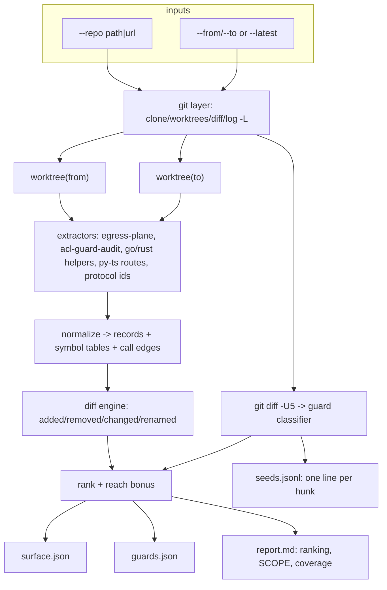
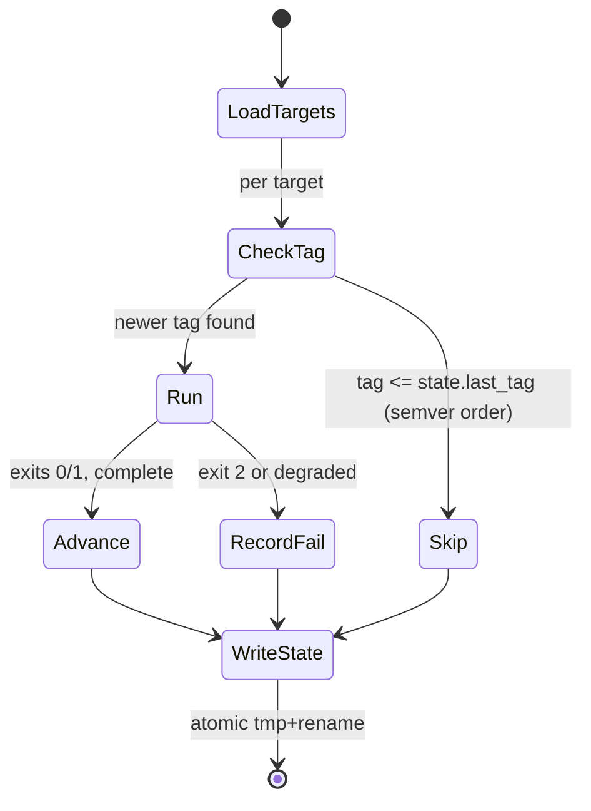

# release-surface-diff - Plan

## Goal Capsule

- **Objective:** A security auditor can run one command against two release tags of a target repo and get the entry points that were added, removed, changed, or renamed, plus the security-relevant diff hunks (added and removed guards), ranked so the highest-risk changes are audited first.
- **Means:** Python 3.11 orchestrator driving git worktrees, external extractor CLIs, and two in-repo extractor binaries; results normalized, diffed, ranked, and written as JSON + markdown under `out/` (KTD1).
- **Authority:** `docs/SPEC.md` is the product contract; this plan's KTDs own implementation mechanism. Where they conflict, the spec wins on behavior and output shapes.
- **Stop conditions:** any change to the four output contracts, the normalized record schema, or the milestone order requires user sign-off; never run target code or tests; never judge exploitability.
- **Execution profile:** code; phased delivery matching spec milestones M1-M5.
- **Tail ownership:** the watch-mode unit (U9) owns `targets.toml`/`state.json` semantics; validation unit (U10) owns real-repo recall gates and is the last unit to land.

---

## Product Contract

### Summary

This plan builds `release-surface-diff`, the release-to-release attack-surface diffing tool described in `docs/SPEC.md`: an orchestrator CLI that extracts each snapshot's entry-point surface, diffs two snapshots, classifies security-relevant code hunks between them, and emits machine-readable output for the harness. Coverage is Go and Rust first plus outbound surface in all four languages, with Python and TS handler coverage through a new in-repo route extractor that closes the acl-guard-audit blind spot.

### Problem Frame

Fresh code is the least-audited code. The existing surface extractors (`egress-plane`, `acl-guard-audit scan`) list entry points for one snapshot only, so new routes, CLI flags, RPC methods, config keys, and exports land unnoticed at release time, and added or removed guards hide inside large release diffs (see origin: docs/SPEC.md).

### Requirements

**Inputs and CLI**

- R1. `run` accepts `--repo <path|url>`, `--from <tag>` / `--to <tag>`, or `--latest` (newest tag vs prior tag in semver order, pre-releases ignored unless `--pre`), `--lang <list>` (default: autodetect from manifests), and `--include`/`--exclude` path globs with defaults excluding tests, vendored, generated, and docs paths.
- R2. `extract --root <tree> --lang <lang>` prints one snapshot's normalized record inventory as JSONL on stdout, for debugging a single extractor.
- R3. `watch --config targets.toml` performs a one-shot check per invocation: for each target, detect a newer tag than the recorded state and run the previous-tag pair once per new tag (KTD9).
- R4. Exit codes: 0 when no delta is found, 1 when any surface or guard delta is found, 2 on tool error.

**Extraction**

- R5. Outbound routes (HTTP clients, sockets, DNS) in Go, Rust, Python, and JS/TS come from `egress-plane scan --format json`, consumed as a black box.
- R6. Python and TS HTTP-handler surface comes from two sources: `acl-guard-audit scan --json` (sink-bearing handlers plus id-param candidates; see KD1) and the in-repo Python/TS route extractor (R7) which covers all discovered routes including paramless ones.
- R7. The Python/TS route extractor emits `route` records for Flask/FastAPI/Django-style registrations in Python and Express/Fastify/Next-style registrations in TS, with templates canonicalized to `{name}` form.
- R8. The Go extractor emits `route`, `rpc`, `cli_flag`, `config_key`, and `export` records covering net/http plus mux/chi/gin/echo/gorilla registrations, gRPC/jsonrpc method registration (including geth-style `apis []rpc.API` namespaces), cobra/`flag`/urfave-cli flags, struct fields with config tags reachable from a config root, and exported identifiers in non-internal packages.
- R9. The Rust extractor emits `route`, `rpc`, `cli_flag`, `config_key`, `export`, and `protocol_id` records covering axum/actix/warp/tonic registration, jsonrpsee `#[rpc]`/`#[method]` attributes, clap derive args/commands, serde config structs (renames honored), pub items in non-`pub(crate)` modules, and libp2p protocol IDs.
- R10. A string-literal pass emits `protocol_id` records for consensus req/resp protocol strings (e.g. `/eth2/beacon_chain/req/`) and gossip topic templates.
- R11. Every extractor emits the normalized record shape: `kind`, `id`, `file`, `line`, `symbol`, `lang`, `extractor`, `attrs` (per origin spec).

**Diff, guards, and outputs**

- R12. Records match on `(kind, id)` into added, removed, changed (handler symbol, middleware chain, file, or body hash differs), and renamed (same body hash under a new id) sets; changed records carry a `body_diff`.
- R13. `git diff -U5 <from>..<to>` on non-test paths feeds a hunk classifier that labels each hunk `class` (`bounds|auth|allowlist|overflow|path|dispatch|other`) and `direction` (`added|removed|modified`) per the spec's pattern rules, with removed guards scoring above added ones.
- R14. Each run writes `out/<repo>/<from>..<to>/surface.json`, `guards.json`, `report.md`, and `seeds.jsonl` in the spec's shapes; `report.md` ranks findings per the spec's scoring formula and carries `SCOPE` and `coverage` sections for harness integration.
- R15. `seeds.jsonl` emits one line per guard hunk in the spec's seed format; the `sha` field resolves via `git log -L` on the hunk range (from-side range for removed hunks), falling back to the tag commit.
- R16. Output ordering is deterministic across runs; `generated_at` is the one intentionally non-deterministic field.
- R17. Missing optional tools (egress-plane, acl-guard-audit, or the helper binaries' toolchains) degrade to a warning plus a gap note in `report.md`, never a silent skip; a supported language whose adapter is absent degrades the same way.

### Key Decisions

- KD1. **Python/TS route coverage is built in-repo, not accepted as a blind spot.** acl-guard-audit emits sites only for handlers containing a recognized data sink, plus id-param routes as candidates; sink-free handlers — including most paramless routes — are invisible to it. (session-settled: user-directed — chosen over accept-and-defer: user judged full entry-point recall worth a second extractor family.) Governs R6, R7.
- KD2. **Full spec scope (M1-M5) in one sequenced plan** rather than stopping at M1-M2. Governs all R-IDs.
- KD3. **Helper binaries are built in-repo and external tools are found on PATH**, per the confirmed synthesis. Governs R5, R6.

### Success Criteria

- On a two-commit synthetic fixture, `surface.json` and `guards.json` match golden files exactly.
- On two adjacent minor tags of coder/coder, the tool recalls at least 90% of manually listed new routes with no more than 10% noise.
- On one reth minor tag pair, new jsonrpsee methods and new CLI args appear; 10 spot-checked guard hunks carry the right class.
- A known historical guard change from a published advisory fix appears in `guards.json` with correct class and direction.
- `watch` run twice with no new tag does no work and exits 0.

### Scope Boundaries

**Outside this product's identity (per origin):**

- Finding bugs or judging exploitability — the tool picks where to look.
- Running target code or tests.
- Replacing the existing extractors.
- Web recon (subdomains, JS endpoint crawling).

**Deferred to follow-up work:**

- Native Python/TS extractors for `cli_flag`, `config_key`, and `export` records (the route kind is covered by U5; the other kinds have no Python/TS coverage and are noted as report gaps).
- Semgrep-augmented hunk classification.

### Sources

- `docs/SPEC.md` — product contract (all sections).
- `../egress-plane` — `crates/egress-cli/src/main.rs` (CLI, exit codes 0/2/3 with valid JSON), `schema/egress-report.v1.json` (site shape).
- `../acl-guard-audit` — `src/acl_guard_audit/cli.py` (CLI, `--json` flag, exit 2 ambiguity), `src/acl_guard_audit/classify.py` (`Site` fields; `_candidate_site` id-param gate at line ~654), `src/acl_guard_audit/routes.py` (canonical `{name}` normalization to mirror), `pyproject.toml` (packaging conventions).

---

## Planning Contract

### Key Technical Decisions

- KTD1. **Three-component split.** A Python 3.11 orchestrator package owns git plumbing, normalization, diffing, guard classification, ranking, reporting, and watch. The Go and Rust extractors are small helper binaries in `helpers/` that read a tree and write normalized JSONL plus a symbol-table sidecar plus intra-package call edges to stdout/stderr-adjacent files. Orchestrator-side modules handle Python/TS routes and protocol-id literals so no third helper is needed.
- KTD2. **Helpers build once into `bin/`.** The orchestrator compiles `helpers/go-extractor` and `helpers/rust-extractor` into `bin/` on first use and rebuilds when sources are newer than the binary; `RSD_GO_EXTRACTOR` / `RSD_RUST_EXTRACTOR` env vars override the path. Chosen over `go run`/`cargo run` per invocation (a `syn`-based binary costs tens of seconds cold and build failures would hide inside scan runs).
- KTD3. **External tools: PATH discovery plus flag/config override; stdout-parse is the success test, not exit code.** egress-plane exits 0/2/3 with valid JSON; acl-guard-audit exit 2 is ambiguous between operational failure (stderr only) and incomplete analysis (JSON on stdout). The adapter consumes stdout whenever it parses, propagates `completeness`/coverage into report gap notes, and marks deltas computed from an incomplete side as low-confidence. A totally unparseable result degrades per R17.
- KTD4. **Repo URLs clone as `--filter=blob:none` partial clones, not shallow-by-tag.** Spec text says shallow-by-tag, but a shallow clone has no inter-tag history and `git log -L` (R15) would always fall back to the tag commit. Blobless clone keeps history at low upfront cost and lazily fetches blobs for worktree checkouts and diffs; fall back to shallow-by-tag fetch when the remote rejects filters.
- KTD5. **Canonical `id` composition per kind; ordinal tie-break on residual collisions.** `route` = `METHOD {template}` (`ANY {template}` when the source method is null); `rpc` = method name; `cli_flag` = `--name`; `config_key` = dotted path; `export` = qualified name; `outbound` = `mechanism:dest-kind:dest-value`; `protocol_id` = the literal. Canonical `lang` tokens are `go|rust|python|ts` (JS variants fold into `ts`). When two records in one snapshot share `(kind, id)`, disambiguate by sorted ordinal of `(file, symbol)`; leftover unmatched records are adds/removes, not changes.
- KTD6. **`changed` includes body-hash drift; `renamed` requires a unique match.** A record with the same `(kind, id)` whose handler body hash changed counts as `changed` with `body_diff` attached — otherwise a handler rewritten in place is invisible. Rename detection requires exactly one removed and one added record sharing a body hash whose body is at least 8 non-blank lines; ambiguous ties and shorter bodies resolve to add+remove.
- KTD7. **Symbol tables are the shared sidecar.** Each extractor emits `(file, symbol, start_line, end_line)` ranges; they serve enclosing-symbol attribution for guard hunks, `body_diff` extraction, and body hashing from one mechanism. The diff `@@` context string is a fallback only.
- KTD8. **Reach bonus comes from helper-emitted call edges, not name matching.** Go/Rust helpers emit `(caller_symbol, callee_symbol)` edges resolvable within the same package/module; the orchestrator marks hunks whose symbol is reachable from a new or changed entry point.
- KTD9. **Watch is one-shot per invocation with atomic state.** `state.json` maps each target to `{last_tag, last_run_exit, last_checked, degraded}`; it is written via tmp-file-plus-rename. A failed run (exit 2) or a degraded run (an extractor was missing, so coverage was partial) records the outcome but does not advance `last_tag`, so the pair retries on the next invocation. `watch` exits 0 when the check completes regardless of deltas found, 2 only when a target run fails or config is invalid. Tag ordering uses the same tolerant semver as `--latest`. Chosen over a daemon loop: the spec's idempotence test describes a finite invocation and scheduling is the operator's job.
- KTD10. **Guard classifier: fixed class precedence, `modified` direction, `log -L` on the from-side for removed hunks.** A hunk matching several patterns takes the first class in this precedence order: bounds, auth, allowlist, overflow, path, dispatch, other. `modified` means the hunk contains both added and removed matching lines. `evidence` is the matched line truncated at 200 chars; `repo` is the remote's last two path segments (owner/name, matching the seed contract) else the directory name, and `out/<repo>/` uses the same value; `parent` is the introducing commit's parent else the tag's parent; annotated tags peel via `^{commit}`.
- KTD11. **Include/exclude filters enforce at two points.** Records from black-box tools are filtered post-hoc on `file`; the same matcher gates which paths the guard classifier scans in the diff. Default excludes cover test files/dirs, vendored trees, generated code, and docs.
- KTD12. **Python/TS route extractor is an orchestrator module.** Python routes come from `ast` decorator/call inspection (Flask/FastAPI/Django `path()`/`re_path()`/decorators); TS routes come from regex pattern rules over `app|router.{verb}(` registrations plus Next.js `app/**/route.*` and `pages/api/**` file conventions; templates normalize to the same `{name}` canonical form acl-guard-audit uses. (session-settled: user-directed — chosen over relying on acl-guard-audit alone: it misses sink-free handlers.) Implements R7 under KD1.
- KTD13. **Packaging mirrors acl-guard-audit:** hatchling build, `src/` layout, `argparse` CLI with `EXIT_*` constants and epilog help, `[project.scripts]` entry, `pytest` under `tests/`.
- KTD14. **Worktree lifecycle.** `git worktree prune` runs before adding; worktrees live in a temp dir outside the target repo and are removed in a `finally`/atexit path; partial failures still clean up.

### Risks & Dependencies

| Risk / dependency | Mitigation |
|---|---|
| Adapter schema drift (`egress-report` v1, `acl-guard-audit/v1` can change upstream) | Adapters check `schema_version` and degrade to a gap note on mismatch (U2) |
| acl-guard-audit transitively requires semgrep; absent semgrep fails its scan | Treated as "adapter missing" — warning + gap note per R17; never a silent skip |
| `git worktree add` writes metadata into the target repo's `.git`; crashes leave stale entries | `prune` on start, temp-dir worktrees, finally/atexit cleanup (KTD14) |
| `--filter=blob:none` unsupported by some remotes | Shallow-by-tag fallback (KTD4); `log -L` degrades to tag commit on shallow clones per spec |
| Helper toolchains (go, cargo) absent on a machine | Discovery degrade per KTD2/R17 — warning + gap note, run continues on remaining coverage |
| Rename detection false positives on trivial identical bodies | Unique-match + size floor (KTD6); ties resolve to add+remove |
| Real-repo validation needs network and large clones | U10 records results in `docs/validation.md` as a manual gate, not CI |
| cve-variant-sweep is not on this machine; seeds.jsonl is an unchecked output contract | Emit the spec's documented shape exactly; flag `docs/validation.md` when a real consumer exists |

### High-Level Technical Design





### Output Structure

```text
pyproject.toml
src/release_surface_diff/
  __init__.py            # version
  __main__.py            # python -m entry -> cli.main
  cli.py                 # argparse: run / extract / watch
  config.py              # flags, targets.toml, state.json
  gitops.py              # clone, tag resolution, worktrees, diff, log -L
  records.py             # normalized record + symbol/call-edge types, canonical ids
  extract.py             # language dispatch, helper discovery/build, adapter runner
  adapters/egress.py     # egress-plane scan --format json -> records
  adapters/aclguard.py   # acl-guard-audit scan --json -> records
  adapters/helpers.py    # go/rust helper subprocess runner
  extractors/py_ts_routes.py  # Python ast + TS pattern route discovery
  extractors/protocol_ids.py  # consensus/gossip string literals
  diff.py                # match/changed/renamed + body_diff
  guards.py              # hunk classifier
  rank.py                # scoring + reach bonus
  report.py              # report.md, SCOPE + coverage sections
  seeds.py               # seeds.jsonl + log -L attribution
  watch.py               # watch mode + state
helpers/
  go-extractor/          # go.mod, main.go, extractor files
  rust-extractor/        # Cargo.toml, src/main.rs, extractor files
tests/
  fixtures/<lang>/       # small trees with golden record lists
  test_*.py
bin/                     # built helpers (gitignored)
```

---

## Implementation Units

| Unit | Title | Key files | Depends on |
|---|---|---|---|
| U1 | Orchestrator scaffold: CLI, git layer, record model | pyproject.toml, cli.py, gitops.py, records.py, config.py | — |
| U2 | External adapters + tool discovery | adapters/egress.py, adapters/aclguard.py, extract.py | U1 |
| U3 | Diff engine + surface.json | diff.py, tests for match/change/rename | U1 |
| U4 | Go extractor helper | helpers/go-extractor/ | U1, U2 |
| U5 | Python/TS route extractor + protocol-id pass | extractors/py_ts_routes.py, extractors/protocol_ids.py | U1, U2 |
| U6 | Guard classifier + guards.json + seeds.jsonl | guards.py, seeds.py | U1, U3 |
| U7 | Ranking + report.md (SCOPE, coverage) | rank.py, report.py | U3, U6 |
| U8 | Rust extractor helper | helpers/rust-extractor/ | U1, U2 |
| U9 | Watch mode | watch.py, config.py | U1, U7 |
| U10 | Validation: fixtures, synthetic repo, real targets | tests/, validation notes | U2, U3, U4, U5, U6, U7, U8 |

### U1. Orchestrator scaffold: CLI, git layer, record model

- **Goal:** A runnable `release-surface-diff` skeleton that resolves tags, produces two worktrees plus a diff, and defines the normalized record contract every later unit emits.
- **Requirements:** R1, R2, R4, R11, R16, R17.
- **Dependencies:** none.
- **Files:** `pyproject.toml`, `src/release_surface_diff/__init__.py`, `src/release_surface_diff/__main__.py`, `src/release_surface_diff/cli.py`, `src/release_surface_diff/config.py`, `src/release_surface_diff/gitops.py`, `src/release_surface_diff/records.py`, `tests/test_gitops.py`, `tests/test_records.py`.
- **Approach:**
  1. Package per KTD13: hatchling, `src/` layout, `argparse` with `run`/`extract`/`watch` subcommands (`watch` may stub until U9), `EXIT_*` constants, epilog exit-code help.
  2. `records.py` defines the normalized record dataclass, canonical `id` builders per kind (KTD5), and the symbol-table and call-edge sidecar shapes.
  3. `gitops.py` owns: local-path vs URL repo handling (KTD4), tag listing + tolerant semver ordering for `--latest`/`--pre` (strip `v`, pad `N.N`, skip unparseable with a stderr note), `git worktree prune` + add per tag into a temp dir outside the target repo with finally/atexit cleanup (KTD14), `git diff -U5` capture, `git log -L` helper (from-side ranges for removals, KTD10).
  4. `config.py` holds flag parsing helpers, default include/exclude globs, and the two-point filter matcher shared with U6 (KTD11).
- **Patterns to follow:** `../acl-guard-audit/src/acl_guard_audit/cli.py` for argparse shape, exit constants, and error-to-stderr discipline.
- **Test scenarios:**
  - Happy path: `extract --root tests/fixtures/go/basic --lang go` prints parseable JSONL once a stub extractor exists; CLI returns 0.
  - Edge: `--latest` on a fixture repo with tags `v1.0.0`, `v1.1.0`, `v1.2.0-rc1` selects `v1.0.0..v1.1.0`; with `--pre` it selects `v1.1.0..v1.2.0-rc1`; a non-semver tag in the list is skipped with a note.
  - Edge: a repo with fewer than two parseable tags exits 2 with a clear message.
  - Error: nonexistent `--repo` path exits 2; `--from == --to` exits 2; reversed tag pair exits 2 with a message naming the semver order.
  - Integration: a temp git repo with two commits; worktrees appear under the temp dir (never inside the target repo), files from each tag are readable, and all worktrees are gone after the command returns — including when extraction raises mid-run.
- **Verification:** `pytest tests/test_gitops.py tests/test_records.py` green; `python -m release_surface_diff --help` shows all three subcommands.

### U2. External adapters and tool discovery

- **Goal:** Adapters that run `egress-plane scan --format json` and `acl-guard-audit scan --json` against a worktree and yield normalized `outbound`/`route` records, plus the shared tool-discovery and degrade policy.
- **Requirements:** R5, R6, R17.
- **Dependencies:** U1.
- **Files:** `src/release_surface_diff/extract.py`, `src/release_surface_diff/adapters/__init__.py`, `src/release_surface_diff/adapters/egress.py`, `src/release_surface_diff/adapters/aclguard.py`, `src/release_surface_diff/adapters/helpers.py`, `tests/test_adapters.py`.
- **Approach:**
  1. Discovery order per tool: explicit flag (`--egress-plane <path>` etc.) > env var > PATH > degrade warning (KTD3). Helper binaries resolve via KTD2 (bin/ + env override + stale rebuild).
  2. Success test is parseable stdout JSON, not exit code (KTD3); adapter returns `(records, completeness_notes, warnings)`; deltas from an incomplete side get a low-confidence flag carried on the affected records' `attrs` and surfaced in U7's report.
  3. `adapters/egress.py` maps `sites[]` to `outbound` records: `id` = `mechanism:dest-kind:dest-value` (KTD5), `file`/`symbol`/`line` from site fields (`location` may be null — omit `line` then), `lang` normalized (javascript → `ts`), sites labeled `test|vendored|generated` still pass through the KTD11 filter; `completeness` and `blind_spots` become gap notes.
  4. `adapters/aclguard.py` maps every site in `findings` + `recognized_complete` + `candidates` to `route` records: `id` = `METHOD {route}` (`ANY {route}` when `method` is null), `file` = `path`, `line` = `entry_start`, `symbol` = `function`, lang from extension; `test_path` sites are filtered; verdict fields are ignored; a site with no `route` emits no record and counts as a gap note per R17.
  5. Both adapters verify the payload's `schema_version` field (egress `1`, acl `acl-guard-audit/v1`) and downgrade to a gap note on mismatch rather than trusting a drifted shape.
  6. `adapters/helpers.py` is the generic runner for the U4/U8 binaries: subprocess with timeout, JSONL on stdout, sidecar paths (symbol table, call edges) via flags.
- **Patterns to follow:** `../acl-guard-audit/src/acl_guard_audit/runner.py` for bounded-subprocess conventions.
- **Test scenarios:**
  - Happy path: a fake `egress-plane` executable on PATH emitting the schema's JSON shape maps to expected `outbound` records including `mechanism:env:API_URL` and `mechanism:literal:<host>` id forms.
  - Edge: fake adapter exiting 2 with valid JSON still yields records plus a completeness warning; a site with null `location` yields a record without `line`.
  - Edge: an acl site with `method: null` (route file, no verb) still maps; `test_path: true` sites are dropped.
  - Error: missing binary produces the degrade warning and a gap-note entry, never an exception; stdout that does not parse degrades the same way.
  - Integration: `extract --root` against a fixture with a stubbed adapter PATH produces records from both tools and a gap note naming any absent tool.
- **Verification:** `pytest tests/test_adapters.py` green; `extract` output against fixtures matches golden JSON.

### U3. Diff engine and surface.json

- **Goal:** The match/classify core: given two record sets, emit added/removed/changed/renamed plus `body_diff`, and write `surface.json`.
- **Requirements:** R12, R14, R16.
- **Dependencies:** U1.
- **Files:** `src/release_surface_diff/diff.py`, `tests/test_diff.py`, `tests/fixtures/diff/` (paired record lists).
- **Approach:**
  1. Match on `(kind, id)`; residual same-key collisions disambiguate by sorted `(file, symbol)` ordinal (KTD5).
  2. `changed` when handler symbol, middleware-chain attr, file, or body hash differs; attach `body_diff` from symbol-table ranges (KTD6, KTD7).
  3. `renamed` only on a unique body-hash pair above the size floor (KTD6); otherwise leftover removed/added stay separate.
  4. Emit the spec's `surface.json` shape with sorted arrays; `generated_at` is the only volatile field (R16).
- **Test scenarios:**
  - Happy path: paired fixture lists produce exact golden `surface.json` (one added, one removed, one changed with `body_diff`, one renamed).
  - Edge: same `id`, same symbol, different body → `changed`, not add+remove.
  - Edge: two added records sharing a body hash with two removed records (tie) → four add/remove entries, no `renamed`.
  - Edge: trivial identical bodies below the size floor → no rename match.
  - Edge: duplicate `(kind, id)` within one side resolves by ordinal deterministically.
  - Error: empty `from` set (missing tool degraded) still yields a valid `surface.json` with everything added plus the low-confidence marker propagated.
- **Verification:** `pytest tests/test_diff.py` green; byte-identical output on repeated runs apart from `generated_at`.

### U4. Go extractor helper

- **Goal:** `helpers/go-extractor` binary that walks a Go tree and emits all Go surface records plus symbol table and call edges as JSONL.
- **Requirements:** R8, R11; reach edges for KTD8.
- **Dependencies:** U1 (record contract), U2 (helper-runner contract for the integration scenario).
- **Files:** `helpers/go-extractor/go.mod`, `helpers/go-extractor/main.go`, `helpers/go-extractor/{routes,rpc,cli,config,exports,symbols,calls}.go`, `helpers/go-extractor/*_test.go`, `tests/fixtures/go/`.
- **Approach:** `go/packages` + `go/ast` per spec: net/http + mux/chi/gin/echo/gorilla route registrations; `RegisterService`/`rpc.Register`/geth `apis []rpc.API` namespaces for `rpc`; cobra `Flags().*`/`flag.*`/urfave `cli.Flag` literals for `cli_flag`; config-tagged struct fields reachable from a config root for `config_key`; exported identifiers in non-internal packages for `export`. Route registrations also capture middleware names visible on the chain (chi `.Use`, gin group middleware, net/http wrapper calls) into `attrs.auth_hint`, giving R12's middleware-chain trigger a producer. Symbol table from declaration ranges; call edges from intra-package `CallExpr` callee resolution. Package load failures degrade per-directory, not per-run.
- **Execution note:** start with the golden fixture in `tests/fixtures/go/` — one file per feature family — before broad framework coverage.
- **Test scenarios:**
  - Happy path: fixture covering `http.HandleFunc`, chi `r.Get`, gin `group.POST`, `grpc.RegisterService`, geth `rpc.API{Namespace:}`, cobra `Flags().String`, `flag.Int`, toml-tagged config struct, exported func → golden record list matches.
  - Edge: `internal/` package exports excluded; generated (`*.pb.go`) files skipped by default filter; route registered with a variable path still emits its literal form when resolvable.
  - Error: a package that fails type-check still yields records for parseable siblings; malformed file is skipped with a stderr warning, not a crash.
  - Integration: binary invoked via `adapters/helpers.py` on a fixture worktree returns records + symbol table + edges that round-trip through normalization.
- **Verification:** `go test ./...` in the helper dir green; `bin/go-extractor <fixture>` output matches golden JSON; coder/coder spot-check deferred to U10.

### U5. Python/TS route extractor + protocol-id pass

- **Goal:** Orchestrator-side extractors covering the acl-guard-audit blind spot (paramless Python/TS routes) and the consensus protocol-id surface.
- **Requirements:** R6, R7, R10, R11.
- **Dependencies:** U1, U2 (acl-adapter records for the dedupe scenario).
- **Files:** `src/release_surface_diff/extractors/__init__.py`, `src/release_surface_diff/extractors/py_ts_routes.py`, `src/release_surface_diff/extractors/protocol_ids.py`, `tests/test_py_ts_routes.py`, `tests/test_protocol_ids.py`, `tests/fixtures/python/`, `tests/fixtures/ts/`.
- **Approach:** Python via `ast`: `app|router.{verb}` decorators and calls, Flask/FastAPI/Django `path()`/`re_path()`/`add_url_rule`. TS via pattern rules: `app|router.{verb}(`, `.route(`, Fastify-style `{ method, url }` objects, Next `app/**/route.*` and `pages/api/**` file conventions; `app.use` middleware chains are recorded into `attrs.auth_hint` where syntactically visible. All templates canonicalize to `{name}` (KTD12; mirror `routes.py` normalization). `protocol_ids.py` owns all bare-literal scanning for req/resp paths and gossip topic templates across every language (R10) — the single producer for `/eth2/...`-style literals.
- **Test scenarios:**
  - Happy path: fixtures with Flask `@app.get("/users/<id>")`, FastAPI `@router.post("/x")`, Django `path("a/<int:pk>")`, Express `app.get("/h/:id")`, Next `app/api/health/route.ts` → records with canonical `GET /users/{id}`, `GET /health` ids.
  - Edge: route with no params (`GET /health`) produces a record — the exact case acl-guard-audit misses; template syntaxes all normalize to `{name}`.
  - Edge: `mounted_prefix` — routes registered under a prefix/join point still produce the joined template.
  - Error: unparseable `.py` skipped with warning; TS file with no route patterns yields nothing.
  - Integration: records merge with acl-adapter records; duplicates (id-param route seen by both) dedupe on `(kind, id)`.
- **Verification:** pytest green; golden fixture lists match; a union with acl records on the same fixture loses no route.

### U6. Guard hunk classifier, guards.json, seeds.jsonl

- **Goal:** Turn `git diff -U5` into classed, directed, symbol-attributed hunks and emit `guards.json` + `seeds.jsonl`.
- **Requirements:** R13, R14, R15.
- **Dependencies:** U1 (diff capture, symbol tables), U3 (surface delta for "inside a changed entry point" boost).
- **Files:** `src/release_surface_diff/guards.py`, `src/release_surface_diff/seeds.py`, `tests/test_guards.py`, `tests/test_seeds.py`.
- **Approach:** Parse diff hunks on paths passing the KTD11 filter; apply the spec's pattern list (bounds/limits, auth calls, allowlist/dispatch arms, checked/saturating/overflow/unwrap, path-URL-host validation) with KTD10 precedence and `modified` direction; attribute enclosing symbol via U1's symbol tables (fallback `@@` context); classify removed-line matches above added per spec. `seeds.py` resolves `sha` via `git log -L` (from-side for removals) with tag-commit fallback, `parent` per KTD10.
- **Test scenarios:**
  - Happy path: synthetic hunk adding `if len(b) > maxFoo { return err }` → class `bounds`, direction `added`, enclosing symbol correct, evidence = matched line.
  - Happy path: removed `check_perm(user)` line → class `auth`, direction `removed`, ranked above an added bound in the same file.
  - Edge: hunk with both added and removed matching lines → `modified`; multi-pattern hunk → first class in precedence order.
  - Edge: hunk in a test file or excluded path is not classified.
  - Error: `git log -L` failing (binary file, range miss) falls back to the tag sha; removed-hunk `log -L` runs against the from-side range.
  - Integration: seeds line fields match the spec example (`repo`, `sha`, `parent`, `source: release-diff`, `class`, `files`, `symbol`, `evidence`).
- **Verification:** pytest green; `guards.json`/`seeds.jsonl` match golden outputs on the synthetic fixture.

### U7. Ranking and report.md

- **Goal:** Score the combined delta, render ranked `report.md` with `SCOPE` and `coverage` sections.
- **Requirements:** R14, R16, R17 (gap notes), plus harness shape tags per spec.
- **Dependencies:** U3, U6.
- **Files:** `src/release_surface_diff/rank.py`, `src/release_surface_diff/report.py`, `tests/test_rank.py`, `tests/test_report.py`.
- **Approach:** Implement the spec scoring (surface delta weight + guard weight + reach bonus from KTD8 edges); sort deterministically with tie-break on `(kind, id)`; render `SCOPE` candidate lines with shape tags (`length-field`, `dispatch=`, `amplify`) guessed from guard class, `coverage` rows per new entry point, and gap notes from adapter completeness + absent tools.
- **Test scenarios:**
  - Happy path: fixture delta (new route + removed bounds check) ranks the removed guard's file high and emits a `SCOPE` line with the right shape tag.
  - Edge: equal scores order by `(kind, id)`; empty delta produces a report stating no delta.
  - Edge: low-confidence flag from an incomplete extraction side appears in the report.
  - Integration: report contains both `SCOPE` and `coverage` sections; every new entry point appears as an uncovered coverage row.
- **Verification:** golden report comparison (excluding `generated_at`); sections present.

### U8. Rust extractor helper

- **Goal:** `helpers/rust-extractor` binary emitting Rust surface records + symbol table + call edges.
- **Requirements:** R9, R11; reach edges for KTD8.
- **Dependencies:** U1, U2 (helper-runner contract for the integration scenario).
- **Files:** `helpers/rust-extractor/Cargo.toml`, `helpers/rust-extractor/src/main.rs`, `helpers/rust-extractor/src/{routes,rpc,cli,config,exports,protocols,symbols,calls}.rs`, `tests/fixtures/rust/`.
- **Approach:** `syn`-based per spec: axum `Router::route`/`.route_service`/`.nest`/`.merge`, actix `App::service`/`web::resource`/`scope`, warp `path().and()` filters, tonic `add_service(XServer::new(..))`, jsonrpsee `#[rpc]`/`#[method(name)]`, clap derive `#[arg]`/`#[command]`, serde config structs honoring `#[serde(rename)]`, `pub` items outside `pub(crate)` modules. For `protocol_id`, the helper emits only structured registrations like `StreamProtocol::new` with non-literal arguments; `protocol_ids.py` owns bare literals including `/eth2/...` strings, so each literal yields exactly one record. Call edges via same-module path resolution; macro-heavy sites degrade to the literal patterns that are visible.
- **Execution note:** build the golden fixture first (one file per feature family); tonic detection keys on generated `*Server::new` call shapes, not on parsing `.proto` output.
- **Test scenarios:**
  - Happy path: fixture with axum router, tonic `add_service`, jsonrpsee `#[method(name = "eth_getProof")]`, clap derive struct, serde config with rename, `pub fn` + `pub(crate) fn`, `StreamProtocol::new("/eth2/...")` → golden records.
  - Edge: `#[serde(rename)]` emits the renamed key; `pub(crate)` items excluded; route built via `.nest("/api", inner)` carries the joined prefix.
  - Error: file failing `syn` parse skipped with warning; macro-generated registrations not visible syntactically are noted as a gap, not fabricated.
  - Integration: binary via `adapters/helpers.py` round-trips through normalization and diffing.
- **Verification:** `cargo test` green; golden JSON match; reth tag-pair check deferred to U10.

### U9. Watch mode

- **Goal:** `release-surface-diff watch --config targets.toml` — one-shot new-tag check per target that runs the previous-tag pair and updates `state.json` atomically.
- **Requirements:** R3; KTD9 semantics.
- **Dependencies:** U1 (config/git), U7 (run pipeline).
- **Files:** `src/release_surface_diff/watch.py`, `src/release_surface_diff/config.py`, `tests/test_watch.py`, `tests/fixtures/targets.toml`.
- **Approach:** Parse `[[target]]` entries (repo, lang, include, exclude); per target: resolve tags, compare newest to `state.last_tag` by tolerant semver, run `run` once per new tag in order, then write state via tmp+rename; a failing run (exit 2) or a degraded run (extractor missing) records `last_run_exit`/`degraded` without advancing `last_tag`, so the pair retries next invocation (KTD9).
- **Test scenarios:**
  - Happy path: fixture config + temp repo; first watch run processes the newest tag pair and advances `last_tag`; second run with no new tag does no work and exits 0 (spec test 6).
  - Edge: two new tags since last run processes each pair in semver order; a backport tag (v1.4.2 released after v1.5.0) orders by semver, not discovery order.
  - Error: a target whose run exits 2 or completes degraded leaves `last_tag` unchanged but records the outcome; a corrupt `state.json` starts fresh with a warning; missing `targets.toml` exits 2.
- **Verification:** pytest green; idempotence scenario passes; state file content matches schema after each case.

### U10. Validation gates

- **Goal:** The spec's test plan executed: golden fixtures per extractor, the synthetic two-commit diff, and real-repo recall checks on coder/coder and reth plus an advisory regression.
- **Requirements:** all R-IDs; success criteria.
- **Dependencies:** U2, U3, U4, U5, U6, U7, U8.
- **Files:** `tests/fixtures/diff-repo/` (build script creating the synthetic tagged repo), `tests/test_e2e_synthetic.py`, `docs/validation.md` (recorded real-repo results).
- **Approach:** Build the synthetic repo in a tmp dir (added route, removed flag, renamed handler, removed bounds check) and assert exact `surface.json`/`guards.json`. Real-repo checks are manual gates: run the tool against two adjacent coder minor tags and one reth tag pair, compare against release notes, record recall numbers in `docs/validation.md`; run the chosen historic advisory fix pair and confirm the guard lands with the right class/direction.
- **Execution note:** real-repo validation needs network + clone time; run it as a manual gate before declaring the plan done, not in CI.
- **Test scenarios:**
  - Synthetic e2e: exact golden match on both JSON outputs and non-empty `seeds.jsonl`; exit code 1 (delta found).
  - Synthetic e2e: identical tag pair exits 2; no-delta pair exits 0.
  - Manual: coder/coder recall ≥ 90%, noise ≤ 10%; reth new jsonrpsee methods + CLI args appear; advisory fix hunks classed correctly.
- **Verification:** pytest e2e green; `docs/validation.md` records the manual results.

---

## Verification Contract

| Gate | Command | Applies to |
|---|---|---|
| Unit tests | `pytest` | all Python units |
| Go helper | `cd helpers/go-extractor && go test ./...` | U4 |
| Rust helper | `cd helpers/rust-extractor && cargo test` | U8 |
| Golden fixtures | `pytest -k fixtures` | U2, U4, U5, U8 |
| Synthetic e2e | `pytest tests/test_e2e_synthetic.py` | U3, U6, U7, U10 |
| Manual recall | `release-surface-diff run --repo <coder clone> --from <t1> --to <t2>` per U10 | U10 |

## Definition of Done

- Every unit's test scenarios are implemented and the Verification Contract gates pass.
- `run` produces all four output files with deterministic ordering; exit codes match R4 including guard-only deltas.
- All spec non-goals hold: no target code executed, no exploitability judgments in output, extractors reused before new code where coverage exists.
- Missing-tool degrade paths emit warnings and report gap notes; partial-JSON consumption marks deltas low-confidence.
- Manual validation results recorded in `docs/validation.md` per U10, or explicitly deferred with the reason noted.
- No abandoned-attempt or scratch code left in the diff; `bin/` and worktree temp dirs are not committed.

## Appendix

### Adapter field mappings

**egress-plane `sites[]` → `outbound` record**

| Site field | Record field | Note |
|---|---|---|
| `mechanism`, `destination.kind`, `destination.value` | `id` = `mechanism:kind:value` | canonical per KTD5 |
| `file`, `symbol` | `file`, `symbol` | |
| `location.line` | `line` | omitted when `location` null |
| `language` | `lang` | `javascript` → `ts` |
| `labels[]` | filter input | `test`/`vendored`/`generated` via KTD11 |
| `completeness`, `blind_spots` | report gap notes | not records |
| exit 0/2/3 + JSON | consume | exit 1 = tool error |

**acl-guard-audit sites (`findings` + `recognized_complete` + `candidates`) → `route` record**

| Site field | Record field | Note |
|---|---|---|
| `method`, `route` | `id` = `METHOD {route}` | `ANY {route}` when method null; no-route sites become gap notes |
| `path` | `file` | |
| `entry_start` | `line` | |
| `function` | `symbol` | |
| file extension | `lang` | `python` / `ts` (js variants fold into `ts`) |
| `test_path` | filter | true → drop |
| `state`, `classes`, `id_params`, `rw` | ignored | verdicts unused per spec |
